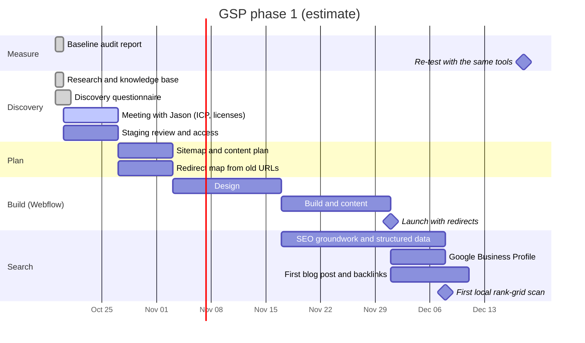

# Status

Last updated: 2026-10-21.

Newest items at the top of each list. Tick items off (`[x]`) and add the date; never delete them.

## Timeline (first phase, about 2 months)

Planned dates are estimates from the 2026-10-19 kickoff. Adjust as the client answers come in.

## Checklist

### To do

- [ ] Follow up on questionnaire gaps: FMC license number, "Allpoint", CJK conflict, project cargo, public email and phone, logo files ([cue card](next-meeting.md))
- [ ] Container spec page: confirm three figures, then rebuild as an HTML table
- [ ] Re-test in December 2026 with the same tools; fill the December column of the [audit report](../deliverables/2026-10-19-baseline-audit/)
- [ ] Decide how to treat the spam backlinks ([decision 0006](../decisions/0006-spam-backlinks.md)) and whether the report shows them
- [ ] Get recent form submissions from GSP (genuine vs junk) for the inquiry baseline; team has asked
- [ ] Decide where logins are kept ([decision 0002](../decisions/0002-credentials.md))
- [ ] Sitemap and content plan for the Webflow build, benchmarked against IFT and Atlantic Pacific Lines ([direct competitors](../research/2026-10-19-direct-competitors.md))
- [ ] Review the contractor's staging site with screenshots
- [ ] Decide Search Console timing ([decision 0004](../decisions/0004-search-console-timing.md)); either way, build a full 301 redirect map before launch
- [ ] Meet Jason: remaining questions ([cue card](next-meeting.md))

### Done

- [x] 2026-10-21 Discovery questionnaire synthesized: lanes Poland and UAE, export forwarding, buyers call or email, FMC license claimed ([synthesis](../research/2026-10-21-discovery-questionnaire.md)); container spec sheet received
- [x] 2026-10-19 Baseline audit report for Jason: PageSpeed mobile and desktop, WAVE, local grid, AEO ([report](../deliverables/2026-10-19-baseline-audit/), [detail note](../research/2026-10-19-baseline-detail-wave-semrush-backlinks.md))
- [x] 2026-10-19 Design principle recorded: familiar, utilitarian, built for the ICP ([decision 0005](../decisions/0005-familiar-utilitarian-design.md))
- [x] 2026-10-19 Direct competitor research: NJ, East Coast, U.S. ([research](../research/2026-10-19-direct-competitors.md))
- [x] 2026-10-19 SEO baseline and design-reference competitors ([baseline](../research/2026-10-19-seo-baseline.md), [competitors](../research/2026-10-19-competitors.md))
- [x] 2026-10-19 Trust signals and backlink plan ([research](../research/2026-10-19-trust-signals-and-backlinks.md))
- [x] 2026-10-19 Site audit and online presence research ([audit](../research/2026-10-19-current-site-audit.md), [presence](../research/2026-10-19-online-presence.md))
- [x] 2026-10-19 Knowledge base set up

## Blocked on

- Client access: domain registrar and DNS, current hosting/WordPress, Google accounts.
- Brand assets from the client.

## Known issues

- Google Site Kit on the WordPress site is stuck at "preparing to set up". Not worth fixing; Search Console via DNS replaces it.

## Context

Rebuilding GSP's website and brand presence, with SEO, AEO and GEO groundwork; after the site is built, SEO then Google Business Profile. See [scope.md](scope.md).
